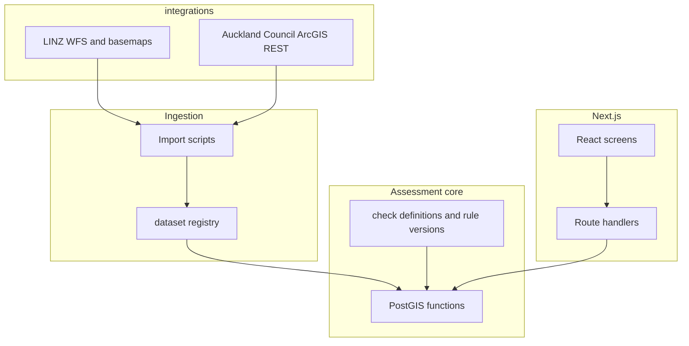

# Auckland Property Check — technical specification

Consolidated from the technical brief and proposed stack, with implementation notes for this repository.

## Build objective

Create a responsive web application that turns **verified public property data** into **reproducible, source-linked findings** for Auckland residential properties.

The core assessment must use **database queries and explicit rules**. AI is optional for explaining findings; it must **not** determine whether a mapped hazard or restriction applies.

## Stack (agreed)

| Component | Choice | Role |
|-----------|--------|------|
| Editor | Cursor | Development |
| Framework | Next.js (App Router) | UI, server routes, deployment unit |
| UI | React + TypeScript | Interactive screens, type safety |
| Styling | Tailwind CSS | Layout, accessibility-friendly labels + colour |
| Database | Supabase PostgreSQL + **PostGIS** | Parcels, layers, runs, findings, cache |
| Auth | Supabase Auth | Saved shortlists only (anonymous first search) |
| Maps | MapLibre GL JS | Parcel confirm, evidence overlays |
| Basemap | LINZ Basemaps | Context + attribution |
| Hosting | Vercel | Next.js |
| Validation | Zod | API inputs/outputs |
| Testing | Vitest + Playwright | Rules + journeys |
| VCS | Git / GitHub | History, CI |

**Verdict:** This stack fits the brief. PostGIS in Supabase is the right place for parcel intersection logic; MapLibre + LINZ basemaps match NZ mapping norms; Next.js route handlers keep API keys off the client.

### Minor recommendations (not stack changes)

1. **Imports off Vercel** — Large council/LINZ imports should run via GitHub Actions, local `tsx` scripts, or Supabase scheduled jobs. Do not rely on serverless request timeouts for bulk geometry loads.
2. **Connection pooling** — Use Supabase pooler (transaction mode) from Vercel for PostGIS queries; avoid opening raw connections per request.
3. **LINZ address schema** — LINZ is migrating address datasets (2026). Wrap address fields in a small adapter so WFS layer/field changes do not ripple through the app.
4. **Optional AI later** — Keep explanation copy in versioned templates (`check_id` + `rule_version`); treat any LLM as a renderer of structured findings only.
5. **PDF v1** — Browser print CSS first; add server PDF (e.g. `@react-pdf/renderer` or a microservice) only if print quality or pagination becomes a blocker. **This PDF is the paid product** (NZ$25–30 per report, see [BRIEF.md](./BRIEF.md)); it must render from the persisted assessment snapshot so it is reproducible from dataset + rule versions.

## Architecture

```
Official datasets → validated imports (or scoped live queries) → PostGIS checks → structured findings → report / compare / export
```



**Separation rule:** `integrations/*` talk to upstream APIs; `assessment/*` and SQL encode rules; `findings/*` map results to product copy. An upstream API change should not require rewriting UI or wording.

## Data sources and verification

| Source | Intended use | Requirement |
|--------|--------------|-------------|
| LINZ Data Service | Addresses, parcels | Document datasets, licences, update schedules; Auckland clips |
| LINZ Basemaps | Imagery and map context | Configure access + attribution in UI |
| Auckland Council GIS / open data | Flood (overland flow, flood prone, coastal inundation), landslide susceptibility, coastal erosion, tsunami, Unitary Plan zones + overlays | Verify **each layer** and its API; record licence (CC BY 4.0) |
| NHCover claims map | Landslide claims history | Free public map; verify reuse terms |
| Council information pages | Explanations and deep links | Store URLs on findings and check metadata |

**Critical:** Public visibility in a map viewer does not prove bulk reuse rights. Catalogue APIs do not contain geometry — import or query feature services directly.

**All v1 checks use free CC BY 4.0 data.** Paid layers (LINZ title, council property file, CoreLogic/QV AVM) are future upsells and must fit the $25–30 report price or be a separate line — see `progress.md` and [BRIEF.md](./BRIEF.md).

Maintain [`docs/dataset-verification.md`](./dataset-verification.md) (per-layer ledger) before enabling checks in production.

## Property identification

- Search using verified address data (LINZ; Auckland-filtered).
- Resolve to **candidate parcels**; user confirms on map.
- Support multiple parcels per property.
- Preserve address and parcel identifiers.
- Flag ambiguous matches → `needs_review`, never silent auto-pick.

Address-to-parcel match is **not** confirmation of legal ownership or title extent.

## Geographic assessment (PostGIS)

- Intersect **full parcel geometry**, not address point alone.
- Distinguish overlap, boundary contact, and proximity where checks require it.
- Use **EPSG:2193 (NZTM2000)** for area/distance; emit **GeoJSON (4326)** for MapLibre.
- Retain hazard **scenario and return-period** fields from source features.
- **Slope is out of scope for v1** — relevant to building, not to buying an existing home; a LIM and a site visit cover it. If reintroduced later, only where DEM coverage/resolution supports it; else `unavailable`.
- Building footprint vs section: only when a verified footprint source exists; otherwise state limitation.

Infrastructure findings must not infer depth, capacity, or surveyed position from a map crossing alone.

## Finding model

Structured fields: check id, rule version, property/parcel ids, status, title, explanation, evidence geometry, source URL, dataset version, source date, retrieval date, intentions, follow-up questions, limitations.

| Status | Meaning |
|--------|---------|
| `detected` | Mapped feature/condition found per rule |
| `not_detected` | Completed check, no match in coverage |
| `unavailable` | Missing, inaccessible, or out of coverage |
| `needs_review` | Ambiguous match or interpretation |

**Never** map API failure or missing coverage to “no issue found.”

## Core database entities

- Datasets and versions (licence, coverage, import status)
- Addresses and parcels (geometry, relationships)
- Assessment runs (parcels, intention, pinned dataset + rule versions)
- Findings (evidence + copy)
- Saved properties (user shortlist, notes)

Persist **assessment snapshots** so exports trace to exact data versions used.

## Interface (five screens)

1. Address search — `/`
2. Parcel confirmation — `/property/confirm`
3. Report (map + findings) — `/property/[runId]/report`
4. Shortlist comparison — `/shortlist/compare` (auth)
5. Printable report — `/property/[runId]/print`

Findings first; expandable evidence; text + colour; readable without map interaction for essential items.

## Data refresh and reliability

- Prefer licensed **imports** into PostGIS for heavy layers; live query only when justified.
- Per-dataset refresh schedule, pagination, retries, timeouts.
- Validate geometry and counts; promote version only after validation; retain last good version on failure.
- Show source dates and stale states in UI.
- Cache assessments on hash(parcel set, intention, dataset versions, rule version).

Start with **Auckland-only** extracts.

## Accounts and security

- Anonymous initial research; auth for saved shortlist.
- Secrets server-side only (`LINZ_API_KEY`, Supabase service role for imports).
- RLS: users access only their saved properties and notes.
- No ownership names in v1.

## Optional AI

v1: template explanations only.

If added: input = structured findings + approved sources; output must reference evidence; preserve `unavailable` / `needs_review`.

## Implementation sequence

1. Verify a small set of real datasets; prove address → parcel → one finding.
2. Build search, map, report around that slice.
3. Add remaining verified checks and intention rules.
4. Auth, compare, print export.
5. Validate coverage and accuracy (20–30 property golden set).

## Acceptance checks

Include coastal, inland, steep, flat, vacant, multi-parcel examples.

Tests must show:

- Rear-of-section hazard detected when address point is outside hazard.
- Ambiguous addresses require confirmation.
- Missing data → `unavailable`.
- Hazard scenarios retain source semantics.
- Every finding cites source + dataset version.
- Saved reports isolated per user.
- Comparison uses consistent checks and surfaces coverage differences.

Demo fixtures: labelled separately from production assessments.

## Repository layout (target)

```
app/                    # routes and API handlers
src/
  integrations/         # LINZ, Auckland Council clients
  datasets/             # registry, import helpers
  assessment/           # checks, run orchestration
  findings/             # schemas, templates
  geo/                  # CRS, GeoJSON helpers
  components/           # map, findings UI
scripts/import/         # dataset jobs
supabase/migrations/    # schema + PostGIS functions
tests/unit/             # Vitest
tests/e2e/              # Playwright
docs/                   # brief, tech, market, dataset ledger
```

## Supabase project (Auckland Property)

| Field | Value |
|-------|--------|
| Project ref | `nwltvcqnflsezmthcfuu` |
| Display name | `auckland-property-check` |
| Region | **`ap-southeast-2` (Sydney)** — closest Supabase region to Auckland |
| API URL | `https://nwltvcqnflsezmthcfuu.supabase.co` |
| Dashboard | [Project home](https://supabase.com/dashboard/project/nwltvcqnflsezmthcfuu) |
| PostGIS | Enabled via migration `enable_postgis` |

Previous EU project `fzrndnyzqqboqcaelgoz` deleted 2026-11-01.

**Local env (do not commit):**

```env
NEXT_PUBLIC_SUPABASE_URL=https://nwltvcqnflsezmthcfuu.supabase.co
NEXT_PUBLIC_SUPABASE_ANON_KEY=<anon key from dashboard Settings → API>
SUPABASE_SERVICE_ROLE_KEY=<service role — server/scripts only>
```

## Environment variables (initial)

| Variable | Where | Purpose |
|----------|-------|---------|
| `NEXT_PUBLIC_SUPABASE_URL` | Client + server | Supabase project |
| `NEXT_PUBLIC_SUPABASE_ANON_KEY` | Client + server | Auth + RLS reads |
| `SUPABASE_SERVICE_ROLE_KEY` | Server/scripts only | Imports |
| `LINZ_API_KEY` | Server/scripts only | WFS |
| `DATABASE_URL` | Scripts (direct) | Migrations / import if needed |

## References

- [Next.js App Router](https://nextjs.org/docs/app/getting-started/installation)
- [Supabase PostGIS](https://supabase.com/docs/guides/database/extensions/postgis)
- [MapLibre GL JS](https://maplibre.org/maplibre-gl-js/docs/)
- [LINZ WFS filtering](https://www.linz.govt.nz/guidance/data-service/linz-data-service-guide/web-services/wfs-filter-methods-and-parameters)
